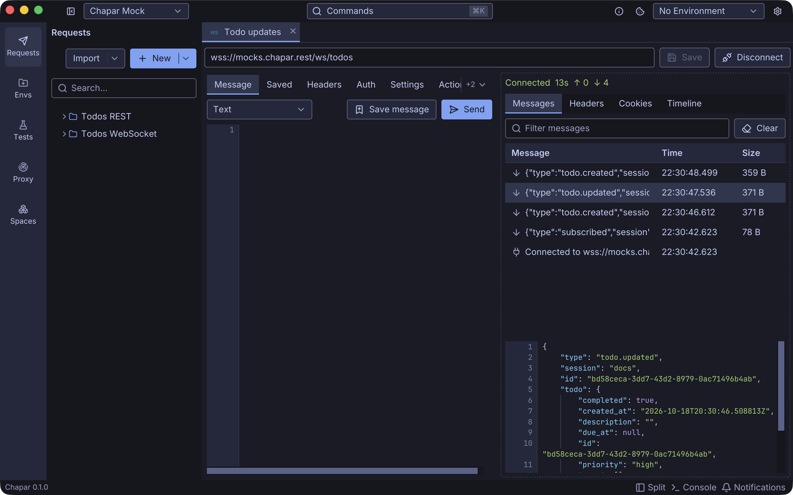
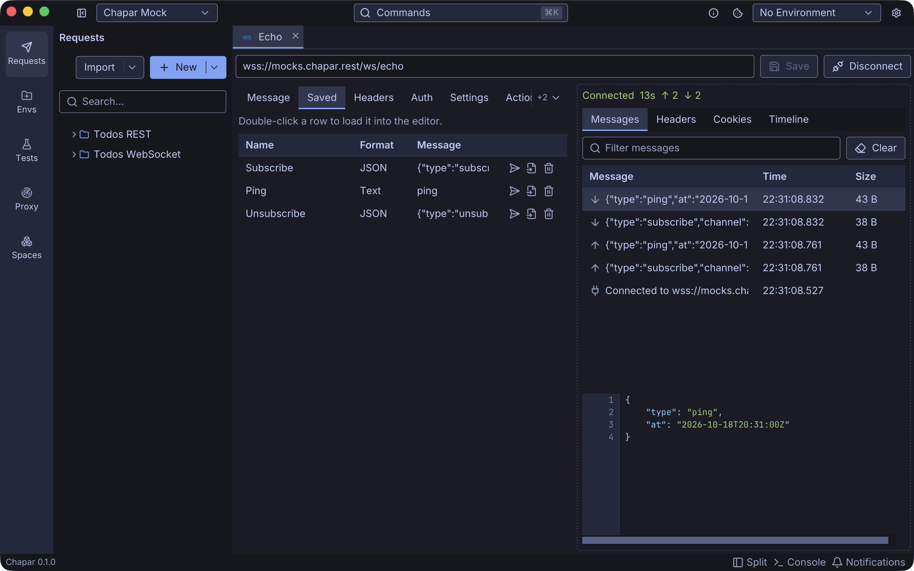
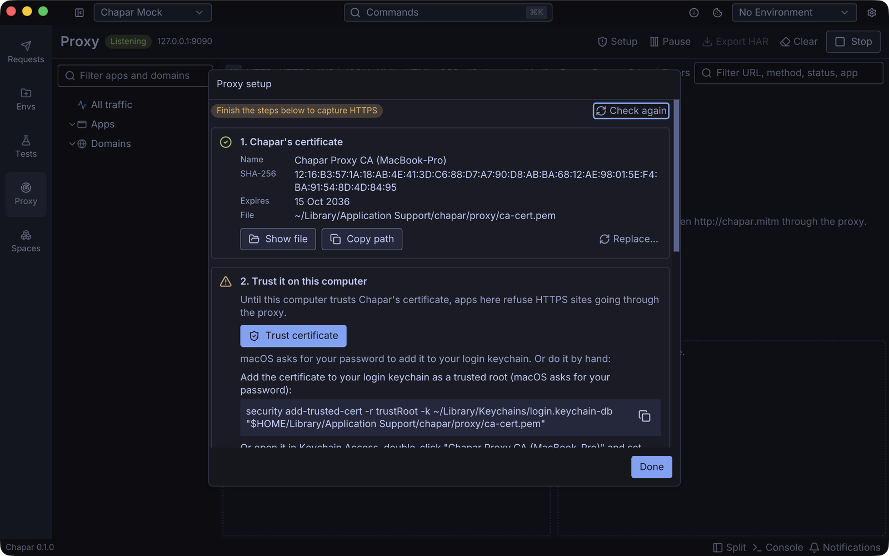
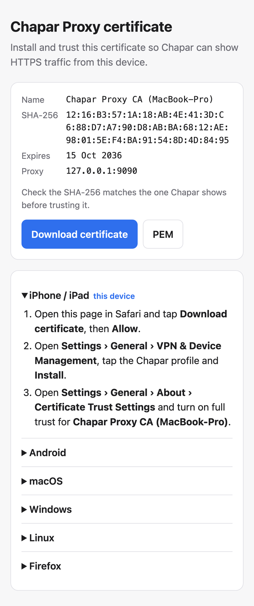

Two releases, two new ways to talk to servers. 0.10 adds WebSocket. 0.11 goes the other way round: instead of sending requests, Chapar watches the ones other apps send.

<!--more-->

## WebSocket requests (0.10)

There's a new request type under **New › WebSocket**. Connect, send messages, and watch everything the server sends arrive in a log, newest first.

- **Messages** can be text, JSON or binary (written as base64). `{{variables}}` are filled in each time you send, so `{{randomUUID4}}` gives every message a new id.
- **Saved messages** live with the request. Keep the ones you send often and send them again from the **Saved** tab with one click.
- **The message log** shows what you sent and what arrived, plus pings, pongs, and the connection opening and closing with its code and reason. Click a message to see it in full: JSON indented, binary as a hex dump.
- **Headers and auth** work like HTTP requests, including your collection's, and the handshake's response headers, cookies and timeline have their own tabs.
- **Settings** for subprotocols, connect timeout, ping interval and compression.

The [mock server](/docs/mockserver/websocket-api/) speaks WebSocket too. `wss://mocks.chapar.rest/ws/echo` sends your messages back, and `wss://mocks.chapar.rest/ws/todos` pushes a message for every change to your todo list: connect it, then create a todo from a REST request with the same session id and watch it arrive. More in the [WebSocket docs](/docs/usingchapar/websocket-requests/).

## A traffic proxy (0.11)

The new **Proxy** page in the left bar runs an HTTP(S) proxy. Point a browser, a command-line tool or your phone at it, and every request and response shows up in a table.

- **Find what you need**: the sidebar lists every app and domain seen so far, and you can pin the ones you care about. Buttons above the table filter by protocol and content type, or show only errors, and the search field matches the URL, method, status or app.
- **Read it**: the request and response sit side by side, with headers, query, body and raw views. JSON is pretty-printed, and compressed bodies are decoded.
- **Know who sent it**: on macOS and Linux Chapar names the app behind each connection, such as *Google Chrome* or *curl*. Phones show up by their address.
- **Reuse it**: **Open in Chapar** turns a captured request into a request in your workspace, ready to edit and send again. **Copy as cURL** gives you a command that pastes safely in a terminal, and **Export HAR** saves what you see for other tools.

The proxy only runs while you have it started, and Chapar never changes your system's proxy settings: you choose which apps go through it.

### Certificates without the fuss

To show HTTPS, the proxy has to decrypt it, which needs a certificate the app trusts. This is usually where proxies get painful, so 0.11 puts a **Setup** guide on the page. It checks each step and says what to do about the ones that aren't ready.

On macOS, trusting Chapar's certificate is one click (macOS asks for your password). On Windows and Linux the guide gives you the command to run, and for terminal tools there's a snippet that points them at the proxy and makes curl, Node and Python trust the certificate.

For a phone, turn on **Allow devices on local network**, set the phone's Wi-Fi proxy to the address Chapar shows, and open **http://chapar.mitm** in its browser. That page is served by Chapar itself: it offers the certificate and the install steps for whatever device is looking at it.

The certificate is made on your computer the first time you start the proxy, its private key never leaves it, and no two Chapar installations share one. The [proxy docs](/docs/proxy/) cover every step, including Firefox and Android.

### Limits

- HTTPS to a bare IP address can't be decrypted.
- WebSocket connections through the proxy are listed, but their messages aren't shown yet.
- Apps that pin their certificates refuse Chapar's. Add their domains to **Don't decrypt** and their traffic passes through untouched.

## A fix for auth

New HTTP and GraphQL requests, including pasted curl commands, showed **Inherit** on their Auth tab while they actually sent no auth. They now show **None**, and requests you already saved this way do too. What they send hasn't changed.

Get 0.11 from the [releases page](https://github.com/chapar-rest/chapar/releases/tag/v0.11.0), or update with Homebrew on macOS.
