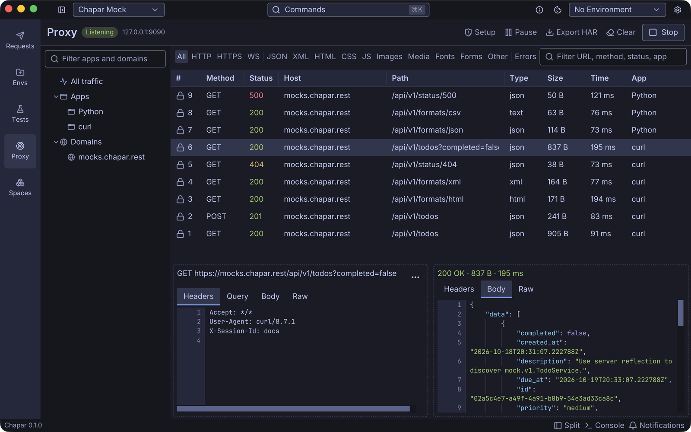

Chapar has a built-in HTTP(S) proxy for looking at the traffic of other apps: a browser, a command-line tool, a mobile app on your phone. Send their traffic through Chapar and every request and response shows up on the **Proxy** page, where you can filter it, read it, and turn any request into a Chapar request.






## How it works

1. Click **Start** on the Proxy page. Chapar listens on `127.0.0.1:9090`.
2. Point the app you want to inspect at that address, as its HTTP and HTTPS proxy.
3. For HTTPS, the app has to trust Chapar's certificate: Chapar decrypts the traffic with a certificate it signs for each site. The [Setup guide](certificates) walks you through it.

Chapar never changes your system's proxy settings, and the proxy only runs while you have it started. It stops when you click **Stop** or quit Chapar.


Captured requests are kept in memory only, up to 5000 requests and 256 MB of bodies by default. They are gone when you quit Chapar unless you [export them as HAR](capturing-traffic#export-har).

